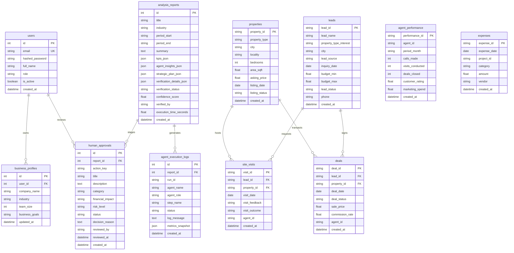

# Relational Database Schema & Entity-Relationship Diagram (ERD)
## Real Estate Decision Intelligence Platform (Apex Realty AI)

### 1. Entity-Relationship Diagram (Mermaid)

---

### 2. Table-by-Table Schema Dictionary

| Table Name | Primary Key | Foreign Keys | Row Count | Purpose & Description |
|:---|:---|:---|:---:|:---|
| `properties` | `property_id` | None | 1,200 | Stores property listings with attributes: bedrooms, square footage, asking price, locality, and status (Available, Sold, Pending). |
| `leads` | `lead_id` | None | 1,800 | Customer inquiries across 6 acquisition channels (Campaign, Referral, Social Media, Walk-in, Portal, Website). |
| `site_visits` | `visit_id` | `lead_id`, `property_id` | 1,200 | Physical inspection logs with customer feedback and outcome (Offer Expected, Second Visit, Follow-up, No Interest). |
| `deals` | `deal_id` | `lead_id`, `property_id` | 600 | Real estate transaction negotiations with agreed sale price, broker commission rate, and status (Closed Won, Closed Lost, Under Negotiation). |
| `agent_performance` | `performance_id` | None | 300 | Monthly broker productivity telemetry: outbound calls, visits completed, deals closed, customer ratings, marketing spend. |
| `expenses` | `expense_id` | None | 500 | Operational expenses categorized by Advertising, Maintenance, Legal, Brokerage, Travel, and Office Rent. |
| `users` | `id` | None | Variable | Platform authentication accounts with salted BCrypt passwords and Role-Based Access Control (`admin`, `manager`, `analyst`, `agent`). |
| `business_profiles` | `id` | `user_id` | Variable | Agency corporate parameters, target revenue goals, team size, and geographical market focus. |
| `analysis_reports` | `id` | None | Variable | Multi-agent execution deliverables containing JSON metrics, agent insights, strategic plans, and verification stamps. |
| `agent_execution_logs` | `id` | `report_id` | Variable | Step-by-step audit trail of CrewAI agent thought processes, tools invoked, and intermediate data outputs. |
| `human_approvals` | `id` | `report_id` | Variable | Consequential strategic actions staged by the Strategy Agent, requiring manager authorization before execution. |
